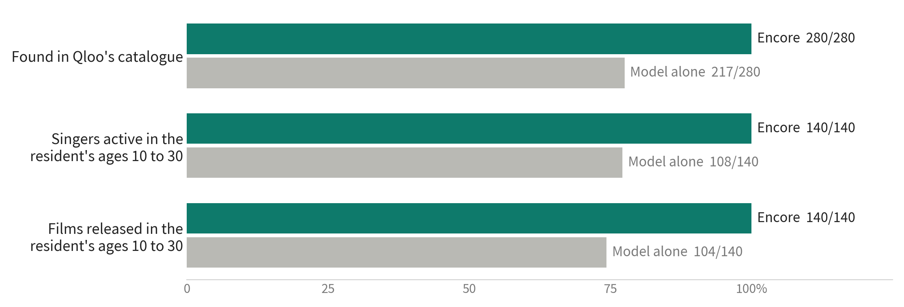
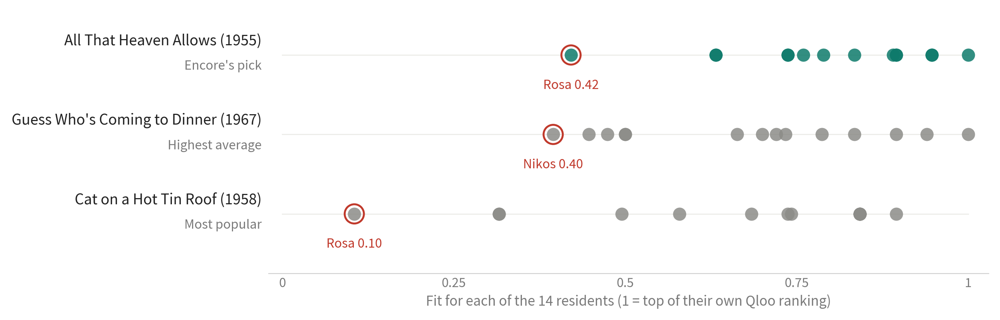
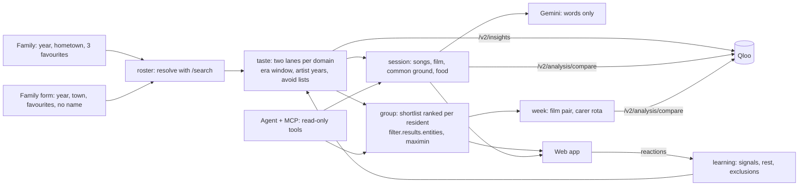

# Encore

**Encore is a taste agent for care-home activity coordinators.** From a birth year, a hometown and three favourites a family can name in a minute, it uses Qloo to find the songs, films and shows of each resident's youth, plans one-to-one reminiscence sessions a carer can run in ten minutes, and picks the lounge film that leaves no resident out.

**Live demo:** https://44-199-155-121.sslip.io (no login; fictional residents). **Try it with someone in your family:** https://44-199-155-121.sslip.io/add **Video (2:52):** https://youtu.be/qP-1_ScSY74

> Thursday, 3 pm, the lounge at Maple Court in Evanston, Illinois. Tomasz, 89, grew up in Kraków and has said little all week. His carer, Priya, is 26 and grew up in Kochi. Encore gives her Czesław Niemen's "Dziwny jest ten świat" to open with, Maryla Rodowicz, a Polish singer nobody at the home has tried with him, Paul Anka's "Diana" as something Qloo finds both of their tastes point to, and a Polish restaurant ten kilometres away. Then it picks a film for all fourteen residents: *All That Heaven Allows* (1955, 89 minutes), the film on the shortlist that serves its least-served resident best. Asked the same question, the model on its own chose a film that resident ranks last.

## What it does

- **The family form.** A visitor tells Encore who someone is to them (Grandma, Dad), the year they were born, where they grew up and up to three favourites. No name is asked. Encore matches the favourites in Qloo, builds the culture of that person's youth, plans a session with a carer and can seat them in today's lounge. The person is visible only to that browser and is removed at the nightly reset.
- **The week.** Two lounge films chosen as a pair, a music hour, and a one-to-one for each resident with the carer whose tastes Qloo's Compare finds closest, with each carer given an even share.
- **The culture of a resident's youth.** People remember most from ages 10 to 30, the reminiscence bump. Encore asks Qloo for films, TV and books released in that window, and for artists active in it, in two lanes: the family's favourites, and home (country of release, or the home country's music genre). Code checks every artist's active years, weights each item by the age the resident was, and interleaves the lanes so a man who grew up in Kraków gets Polish songs as well as Hollywood.
- **One-to-one sessions.** A song the family named, a song from their youth the care team has not tried, a film, something the carer and the resident share, and a taste of home near the care home. Gemini writes the words the carer says ("Tell me about…", never "Do you remember…").
- **The lounge film.** Each resident nominates films from their own youth; Qloo ranks the whole shortlist for every resident's tastes (`filter.results.entities`); Encore picks the film whose least-served resident is served best, and shows what the highest-average and most-popular choices would cost that resident.
- **Music hour.** A playlist where every resident in the room hears an artist that fits them.
- **Learning from sessions.** A carer taps how the resident responded. A song that lit them up becomes a signal in their next Qloo query; no response rests it for two weeks; anything that upset them is excluded at once, and its genres are offered to staff as avoid tags.
- **Ask Encore.** A Gemini agent plans with the same tools (read-only) and shows every tool call with the Qloo requests behind it. The same tools are served over MCP at `/mcp/` for any assistant.
- **The record.** A printable activity record per resident: interests and their source, what to avoid, participation and response. US nursing homes must run an activities programme built on each resident's interests and preferences (42 CFR 483.24(c), survey tag F679).

## How Encore uses Qloo

| Need | Qloo call | Code |
|---|---|---|
| Match the family's words to entities; pick the release from their youth when a title has several | `GET /search` with `types` | [`roster.resolve_favourite`](encore/roster.py) |
| Films, TV and books of ages 10 to 30 | `/v2/insights` with `filter.release_year.min/max` or `filter.publication_year.*`, `signal.interests.entities`, `signal.demographics.age`, `feature.explainability` | [`taste.lanes_for`](encore/taste.py) |
| The home lane | `filter.release_country`, or `filter.tags` with the home country's music genre from `/v2/tags` | [`taste.lanes_for`](encore/taste.py) |
| Music of the era (artists have no year filter) | `filter.tags=urn:tag:genre:music:oldies` plus code checking `properties.start_year` / `end_year` | [`taste.artist_era`](encore/taste.py) |
| Avoid lists and house rules | `filter.exclude.tags` (war films for Tomasz, horror in shared spaces) | [`taste.lanes_for`](encore/taste.py) |
| "Qloo links it to Irena Santor" | `feature.explainability` per seed entity | [`taste.shelf`](encore/taste.py) |
| Rank one shortlist for every resident | `filter.results.entities` + each resident's signals | [`group.affinities`](encore/group.py) |
| Common ground between a resident and a carer | `/v2/analysis/compare`, plus insights seeded by both whose explainability shows both sides pulling | [`common.common_ground`](encore/common.py) |
| Match each resident with a carer for the week | `/v2/analysis/compare` on every resident and carer pair; the shared genres, instruments and themes, with the favourite on each side behind them | [`week.match`](encore/week.py) |
| Food of home near the care home | `/v2/insights` places with `filter.location.query`, `filter.location.radius`, cuisine `filter.tags`, the resident's signals | [`taste.taste_of_home`](encore/taste.py) |
| Full records for the family's picks (notable songs, images) | `filter.results.entities` | [`taste.seed_details`](encore/taste.py) |

Every pick, rank and number on screen comes from Qloo and Encore's code. Gemini writes words only.

## Results

`scripts/evaluate.py` gives the same model (Gemini 3.7 Flash) each resident's birth year, hometown and family favourites and asks for ten singers and ten films from their youth, then looks every answer up in Qloo and scores both lists with the same code. 14 residents, 140 singers and 140 films per side, run 16 Oct 2026.

| Measure | Encore | Model alone |
|---|---|---|
| Answers that exist in Qloo's catalogue | 100% | singers 78%, films 77% |
| Singers active in the resident's ages 10 to 30 | 140/140 | 108/140 (77%) |
| Films released in the resident's ages 10 to 30 | 140/140 | 104/140 (74%) |
| Films from the resident's home country | 86/140 (61%) | 83/140 (59%) |



*Every answer Encore gives exists in Qloo and falls inside the resident's ages 10 to 30. The same model asked on its own: 217 of 280 answers found in Qloo, 108 of 140 singers active and 104 of 140 films released in those years.*

The lounge film, scored on one shared pool (Encore's shortlist plus the model's choice) by each resident's Qloo ranking:

| Rule | Film | Least-served resident's fit | Average fit |
|---|---|---|---|
| Encore: best for the least-served | All That Heaven Allows (1955) | 0.45 | 0.80 |
| Highest average affinity | Guess Who's Coming to Dinner (1967) | 0.40 | 0.69 |
| Most popular on the shortlist | Singin' in the Rain (1952) | 0.00 | 0.33 |
| The model alone | Singin' in the Rain (1952) | 0.00 | 0.33 |



*Each dot is one of the 14 residents, placed by where the film falls in that resident's own Qloo ranking (live demo). Encore's pick keeps its least-served resident at 0.42. The most popular film on the shortlist would leave Rosa at 0.10. Drawn by `scripts/figures.py`.*

The week, on the same 14 residents and the same per-resident Qloo rankings (live demo, 16 Oct 2026):

| | Least-served resident's best film this week |
|---|---|
| One lounge film (All That Heaven Allows) | 0.42 (Rosa) |
| Two films chosen as a pair (adds Laterna, ftoheia kai filotimo, 1955) | 0.63 (Walter); average 0.86 |

Matching one-to-ones by Qloo Compare gives pairs that share 269 genres, instruments and themes in total, against 179 for an alphabetical rota with the same three carers. Tomasz goes to Priya: "Rock: Tomasz's Czesław Niemen and Priya's Coldplay", 38 shared tastes against 5 with Ana.

How the music lanes were tuned: across the 14 residents, Qloo artist results seeded by the family's favourites fall inside the resident's ages 10 to 30 **635 times out of 700 with the oldies genre tag**, against 501 with the 55-and-older age signal, so Encore uses the tag for artists. For people born from 1955 on, the favourites alone keep the most artists in their window (49 of 50 for fans of Madonna and Prince born in 1962), so the family form uses them directly.

## Why this problem

- 14,742 US nursing facilities are certified by CMS, with about 1.24 million residents ([KFF, 2025](https://www.kff.org/medicaid/a-look-at-nursing-facility-characteristics/)). 41.1% of residents had Alzheimer's disease or another dementia in 2022 ([CDC NCHS](https://www.cdc.gov/nchs/fastats/alzheimers.htm)).
- Each must provide "an ongoing program to support residents in their choice of activities ... designed to meet the interests of and support the physical, mental, and psychosocial well-being of each resident" ([42 CFR 483.24(c)(1)](https://www.law.cornell.edu/cfr/text/42/483.24), survey tag F679).
- A Cochrane review of 22 randomised trials with 1,097 people with dementia in institutional care found that music-based interventions probably reduce depressive symptoms and improve overall behavioural problems at the end of treatment ([van der Steen et al., 2018](https://pmc.ncbi.nlm.nih.gov/articles/PMC6513122)).
- 21% of nursing assistants in US nursing homes are immigrants ([PHI, 2025](https://www.phinational.org/news/phi-report-highlights-record-growth-in-direct-care-workforce-warns-federal-policy-changes-threaten-job-qua)), so the carer and the resident often grew up decades and continents apart.
- People recall the most from ages 10 to 30, the reminiscence bump (Rubin, Rahhal and Poon, *Memory & Cognition*, 1998).

## What Qloo sees

Entity IDs, a range of years, a hometown, a genre word and an age bracket. Names, rooms, care notes and reactions stay in Encore's database. The client enforces this with an allow-list ([`qloo.PrivacyGuard`](encore/qloo.py)): free-text parameters may only carry a favourite as the family typed it, a town or a genre word, every other parameter must be an ID, URN, number or country, and any value containing a resident's or carer's name is refused before it leaves. The **What Qloo saw** page lists every request. The key travels only in the `X-Api-Key` header from the server; images are fetched by the server too, because they need the key.

Qloo answers are cached privately on the server (allowed by the hackathon terms) and never committed here. The tests run against a synthetic stand-in ([`tests/fake_qloo.py`](tests/fake_qloo.py)).

## Architecture



## Claims and where to check them

| Claim | Code | Test |
|---|---|---|
| No name or note reaches Qloo across every feature | `encore/qloo.py` `PrivacyGuard` | `tests/test_privacy.py::test_no_name_or_note_reaches_qloo_across_every_flow` |
| The API key never appears in a request URL or the log | `encore/qloo.py` `_fetch`, `_log` | `tests/test_privacy.py::test_api_key_travels_only_in_the_header` |
| Shelves stay inside ages 10 to 30 and honour avoid lists | `encore/taste.py` | `tests/test_taste.py` |
| A title with several releases resolves to the one from their youth | `encore/roster.py` | `tests/test_taste.py::test_same_title_resolves_to_the_release_of_their_youth` |
| The lounge pick maximises the least-served resident's fit | `encore/group.py` | `tests/test_group.py` |
| Lit up becomes a signal; upset excludes; no response rests | `encore/learning.py` | `tests/test_flows.py` |
| Someone added on the family form is seen only by that visitor, never joins the shared lounge unless brought in, and their relation never reaches Qloo | `encore/family.py`, `roster.people` | `tests/test_week_family.py::test_family_form_adds_a_person_only_its_visitor_sees` |
| The week's two films are the pair whose least-served resident's better film fits best | `encore/week.py` `best_pair` | `tests/test_week_family.py::test_two_films_chosen_together_beat_the_two_best_films_taken_separately` |
| Each carer takes at most an even share of one-to-ones, and the strongest match is kept | `encore/week.py` `assign` | `tests/test_week_family.py::test_assignment_respects_each_carers_share_and_keeps_the_strong_pair` |
| The product keeps working on templates without the model | `encore/session.py` `_template`, `encore/agent.py` `_fallback` | `tests/test_flows.py::test_session_plan_uses_template_words_without_a_model`, `::test_agent_falls_back_to_the_matching_tool` |
| Qloo requests retry with backoff and are served from the private cache | `encore/qloo.py` | `tests/test_flows.py` |

## Run it

Requires Python 3.11+ and Node 20+.

```sh
cp .env.example .env            # add QLOO_API_KEY; GEMINI_API_KEY is optional
python -m venv .venv && .venv/bin/pip install -e ".[dev]"
(cd web && npm install && npm run build)
.venv/bin/uvicorn encore.app:create_app --factory --port 8077
```

Open http://127.0.0.1:8077. On first start Encore resolves the favourites and warms its cache for all residents.

- Tests: `.venv/bin/python -m pytest` (33 tests, no network).
- Evaluation: `.venv/bin/python scripts/evaluate.py` (needs both keys; writes `eval/results.json`, shown on the How it works page).
- Figures: `.venv/bin/python scripts/figures.py` (reads `eval/results.json` and the live lounge; writes `docs/figures/`).
- MCP over stdio: `python -m encore.mcp_server`. Over HTTP: `POST /mcp/` on the running server. Tools: `list_people`, `resident_profile`, `lounge_film`, `music_hour`, `plan_one_to_one`, `common_ground`, `week_plan`.
- Deploy: `deploy/provision.sh` then `deploy/redeploy.sh` (AWS t4g.small, Caddy, keys in SSM Parameter Store).

## Data

- The residents, carers and care home in the demonstration are fictional.
- Qloo affinity describes audiences. Encore uses it to order and compare items for a person and for a room.

## Built during the hackathon

Everything in this repository was written for the Qloo hackathon in October 2026.

## License

MIT
